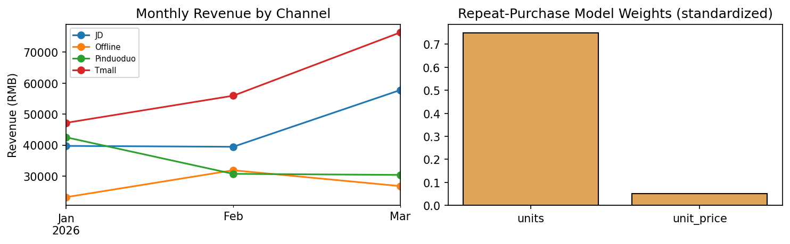

# Multi-Channel Sales Analysis & Repeat-Purchase Prediction
Synthetic data that mirrors my data-analysis internship (medical-supplies sales across Tmall, JD, Pinduoduo and offline channels).

## What it does
- **Data types:** parses dates, converts columns to categoricals, and coerces bad numeric values
- **Wrangling:** standardises inconsistent channel labels and imputes missing prices with the per-category median
- **Analysis:** custom `channel_summary()` reports revenue, orders, average order value, repeat rate and revenue share; also builds a monthly revenue pivot
- **Model:** logistic regression implemented from scratch in NumPy with gradient descent
  - Standardisation is fitted on the training set only, so no information leaks from the test set
  - The collinear `revenue` feature is dropped
  - Results are compared against a majority-class baseline

## Result
Test accuracy is **68.6%**, compared with a 60.5% majority-class baseline (+8.1 pts). Purchase quantity (`units`) is the main driver of repeat purchases.



## Run
```bash
pip install pandas numpy matplotlib
python analysis.py
```

## Author
Peiran (Cynthia) Jing · [github.com/pr000000](https://github.com/pr000000)
